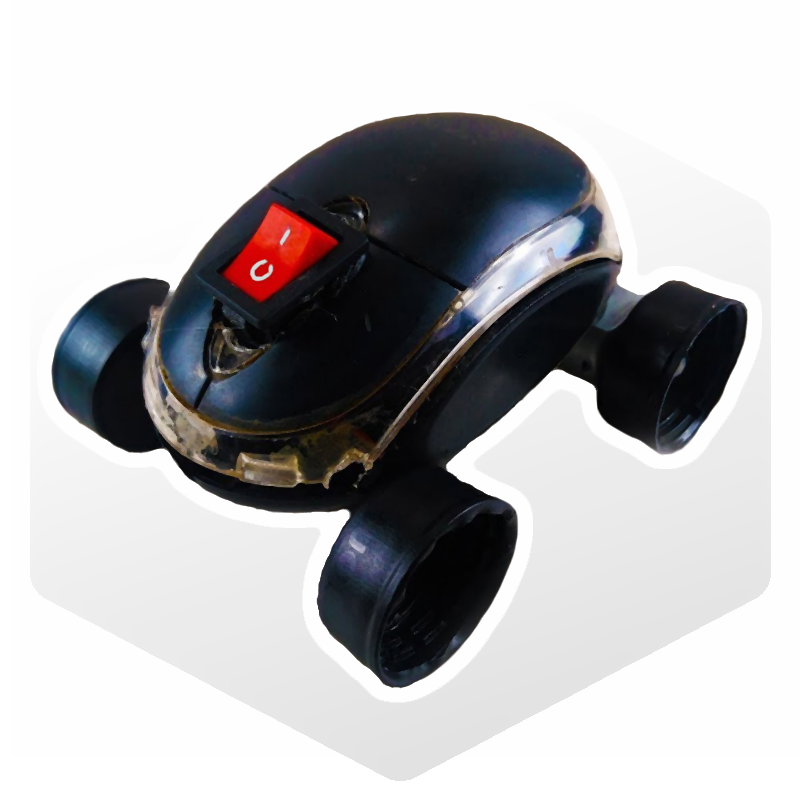

# crack

A post-build web obfuscator. It takes a directory a bundler already produced and
rewrites the JS, HTML and SVG in place: string and template literals into an
encrypted per-file pool, proxy and store names into per-build substitutes, and
embedded wasm names to match. It leaves no sensitive plaintext from the canary
list, and it does not change what the code does.

crack is written in Rust on [OXC](https://oxc.rs) and published to npm as
[`@sysce/crack`](https://www.npmjs.com/package/@sysce/crack). The binary is
`crack`.

**crack raises the cost of reading a build. It does not make the build secret.**
A decoder key ships in each file, and anyone with devtools can run the code. TLS
is the only transport protection. Do not describe the output as secret.

The obfuscation engine is not implemented yet. This repository documents the
stable public surface (the CLI, the Node API, the Rust API, and the integration
steps), not current behavior.

## Install

```sh
npm i -D @sysce/crack
```

The package pulls the matching per-target binary (`@sysce/crack-<os>-<cpu>`) as
an optional dependency. Supported targets: linux x64 and arm64, darwin x64 and
arm64, win32 x64.

## Quick start

Run it over a built directory from the command line:

```sh
npx crack dist
```

Or run it after an esbuild build, over the output directory:

```js
import { build } from 'esbuild'
import crack from '@sysce/crack/esbuild'

await build({
  entryPoints: ['src/index.ts'],
  bundle: true,
  outdir: 'dist',
  plugins: [crack()],
})
```

crack runs exactly once per build. It is not idempotent: a second run would
encrypt the decoder the first run added.

## Documentation

- [CLI reference](docs/CLI.md): every flag, examples, exit codes, the
  fail-closed rule.
- [Node API](docs/NODE-API.md): `obfuscate()`, the esbuild and rsbuild plugins,
  the options object, the `Report` shape.
- [Rust API](docs/RUST-API.md): the `crack-core` public surface.
- [Integration](docs/INTEGRATION.md): esbuild, rsbuild, Vite, and a plain CLI
  step in `package.json`.
- [Wiki](https://github.com/Fracital/crack/wiki): install, configuration,
  source maps, security and limits, contributing.

## Powering

| Site | Link | Repo |
|------|------|------|
|  abstract v2 | abstracteducation.loan (private) | `Fracital/abstract-v2` (private) |
|  Fracital | [fracit.al](https://fracit.al) | [`Fracital/Fracital`](https://github.com/Fracital/Fracital) |
|  SystemYA | [systemya.fracit.al](https://systemya.fracit.al) | [`Fracital/SystemYA`](https://github.com/Fracital/SystemYA) |
|  STomp (powerMouse) | [stomp.fracit.al](https://stomp.fracit.al) | [`Fracital/powerMouse`](https://github.com/Fracital/powerMouse) |
|  Holy Unblocker | [holyunb.locker](https://holyunb.locker) | [`holy-unblocker/website2`](https://github.com/holy-unblocker/website2) |

## Author

David Reed.

## License

ISC. See [LICENSE](LICENSE).
