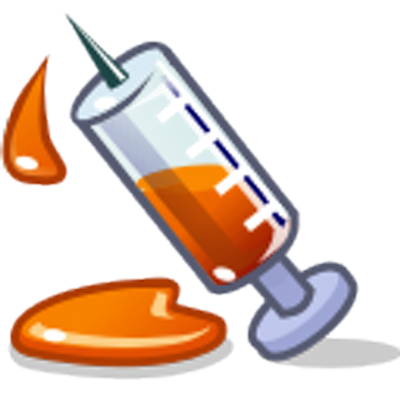

<div align="center">
  
</div>

# @sysce/estrogen

<div align="center">
  <a href="https://www.npmjs.com/package/@sysce/estrogen"></a>
  <a href="https://github.com/Fracital/estrogen/actions/workflows/ci.yml"></a>
  <a href="LICENSE"></a>
  <a href="https://github.com/Fracital/estrogen/issues"></a>
  <a href="https://github.com/Fracital/estrogen/stargazers"></a>
</div>

A post-build web obfuscator. It takes a directory a bundler already produced and
rewrites the JS, HTML and SVG in place. In app scripts it pools strings and
template literals, disguises number and boolean literals as equivalent
expressions, and shortens local names. In vendor scripts it replaces proxy and
store names, plus the matching names in embedded wasm. It leaves no sensitive
plaintext from the canary list, and it does not change what the code does.

It also assembles the build it protects. `estrogen build` vendors packages and
folders, from `node_modules` or a glob, into the served tree under per-build
stamped names, obfuscating them on the way in or copying them verbatim, from a
`[[vendor]]` config. `estrogen --watch` re-runs on each change, and
`--sourcemap <dir>` writes a private V3 source map outside the served tree.
estrogen runs as a command line tool, as esbuild, rsbuild, Vite and Rollup
plugins, and as an Astro integration.

estrogen is written in Rust on [OXC](https://oxc.rs) and published to npm as
[`@sysce/estrogen`](https://www.npmjs.com/package/@sysce/estrogen). The binary is
`estrogen`.

estrogen transforms a shipped build into something more fun to read, for
crawlers, scrapers and the casual copy/paste. The engine is an obfuscator, not
encryption: a decoder key ships in each file, so lean on TLS for transport.

Try it in your browser at [estro.help](https://estro.help): the real engine
compiled to WebAssembly, running locally on what you paste. Nothing is uploaded.

## Install

```sh
npm i -D @sysce/estrogen
```

The package pulls the matching per-target binary (`@sysce/estrogen-<os>-<cpu>`) as
an optional dependency. Supported targets: linux x64 and arm64, darwin x64 and
arm64, win32 x64.

## Quick start

Run it over a built directory from the command line:

```sh
npx estrogen dist
```

Or run it after an esbuild build, over the output directory:

```js
import estrogen from '@sysce/estrogen/esbuild';
import { build } from 'esbuild';

await build({
	entryPoints: ['src/index.ts'],
	bundle: true,
	outdir: 'dist',
	plugins: [estrogen()],
});
```

Or add it to an Astro build, where it runs on `astro:build:done` over the output
directory:

```js
import estrogen from '@sysce/estrogen/astro';
import { defineConfig } from 'astro/config';

export default defineConfig({
	integrations: [estrogen()],
});
```

estrogen runs exactly once per build. It is not idempotent: a second run would
encrypt the decoder the first run added.

To bring packages into the build as well, run `estrogen build dist` with a
`[[vendor]]` config. See the [CLI reference](docs/CLI.md).

## Documentation

- [CLI reference](docs/CLI.md): every flag, examples, exit codes, the
  fail-closed rule.
- [Node API](docs/NODE-API.md): `obfuscate()`, the esbuild, rsbuild, Vite and
  Rollup plugins, the Astro integration, the options object, the `Report` shape.
- [Rust API](docs/RUST-API.md): the `estrogen-core` public surface.
- [Integration](docs/INTEGRATION.md): esbuild, rsbuild, Vite, Rollup, Astro, and
  a plain CLI step in `package.json`.
- [Wiki](https://github.com/Fracital/estrogen/wiki): install, configuration,
  source maps, security and limits, contributing.

## Powering

<table>
<tr><th></th><th>Site</th><th>Link</th><th>Repo</th></tr>
<tr>
<td align="center" valign="middle"></td>
<td valign="middle">abstract v2</td>
<td valign="middle"><a href="https://abstracteducation.loan">abstracteducation.loan</a></td>
<td valign="middle"></td>
</tr>
<tr>
<td align="center" valign="middle"></td>
<td valign="middle">Fracital</td>
<td valign="middle"><a href="https://fracit.al">fracit.al</a></td>
<td valign="middle"><a href="https://github.com/Fracital/Fracital"><code>Fracital/Fracital</code></a></td>
</tr>
<tr>
<td align="center" valign="middle"></td>
<td valign="middle">SystemYA</td>
<td valign="middle"><a href="https://systemya.fracit.al">systemya.fracit.al</a></td>
<td valign="middle"><a href="https://github.com/Fracital/SystemYA"><code>Fracital/SystemYA</code></a></td>
</tr>
<tr>
<td align="center" valign="middle"></td>
<td valign="middle">STomp (powerMouse)</td>
<td valign="middle"><a href="https://stomp.fracit.al">stomp.fracit.al</a></td>
<td valign="middle"><a href="https://github.com/Fracital/powerMouse"><code>Fracital/powerMouse</code></a></td>
</tr>
<tr>
<td align="center" valign="middle"></td>
<td valign="middle">Holy Unblocker</td>
<td valign="middle"><a href="https://holyunb.locker">holyunb.locker</a></td>
<td valign="middle"><a href="https://github.com/holy-unblocker/website2"><code>holy-unblocker/website2</code></a></td>
</tr>
</table>

## Credits

|                                                                               | GitHub                         | Name       |
| ----------------------------------------------------------------------------- | ------------------------------ | ---------- |
|  | [@e9x](https://github.com/e9x) | David Reed |

## License

ISC. See [LICENSE](LICENSE).
